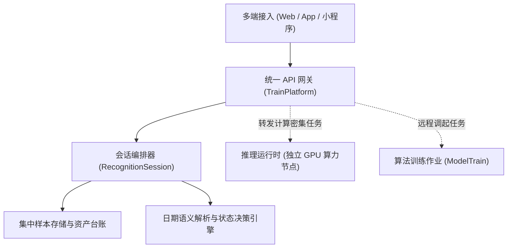

# TrainPlatform · 轻眸识刻业务与数据中枢

> **组织归属**：`QingMouFoodDate` GitHub 组织  
> **仓库性质**：轻眸识刻全系统**业务 API 网关、识别会话编排、全量样本存储与平台管控中心**

---

## 一、 核心定位与职责边界

本仓库作为整个项目的**业务持久化、协同编排与数据管理中枢**，部署于通用业务服务器（以大容量存储、网络 I/O 与通用 CPU 为主），与承担高负载模型推理的 GPU 计算节点保持物理与逻辑解耦：



### 1. 核心职责
- **识别会话编排管理**：以 `RecognitionSession` 为单元管理单件商品多图识别生命周期，汇总跨图证据链；
- **真实日期语义与状态决策引擎**：解析生产日期、到期日、保质期时长与存储条件，依据客观规则输出二维判定状态（标示期限判定 + 复核状态）；
- **全量样本存储与数据管理**：在部署服务器集中存储原始样本图像资产与标注清单，提供多维检索与批处理操作；
- **在线标注中心与质检防重**：提供 Web 端目标框标定与字符转写修正界面，集成拉普拉斯模糊初筛与 SHA-256 / pHash 查重门禁；
- **计算调度与代理分发**：将多端上传的密集推理计算转发至 GPU 算力节点执行，并在管理后台提供模型重训练远程调度入口。

### 2. 边界原则
- 深度学习算法的组网研发、训练调优与消融实验归属于 `ModelTrain`；
- 本仓专注于业务逻辑、数据流转、接口契约保障与系统运行时状态维护。

---

## 二、 推荐架构分层

目录结构遵循领域分层规范，除根目录核心配置文件外，子目录仅展示文件夹层级：

```text
TrainPlatform/
├── README.md
├── requirements.txt / go.mod
├── .env.example
├── .gitignore
└── app/
    ├── api/
    ├── core/
    ├── models/
    ├── schemas/
    ├── services/
    ├── engine/
    └── storage/
```

---

## 三、 跨仓契约绑定

本仓作为跨端通信的核心枢纽，必须保证接口协议与交付标准的严谨一致：
- **客户端接口契约**：严格实现 [`ProjectPRD/contracts/API接口协议.md`](https://github.com/QingMouFoodDate/ProjectPRD/blob/main/contracts/API接口协议.md) 规定的会话生命周期与推断接口；
- **算法模型对接**：遵循 [`ProjectPRD/contracts/模型交付规约.md`](https://github.com/QingMouFoodDate/ProjectPRD/blob/main/contracts/模型交付规约.md) 加载由 ModelTrain 交付的标准化模型资产；
- **数据质量底线**：资产管理与样本流转严格遵循 [`ProjectPRD/standards/数据质量规范.md`](https://github.com/QingMouFoodDate/ProjectPRD/blob/main/standards/数据质量规范.md)。

---

## 四、 技术选型参考

- **路线 A（推荐 · 敏捷全栈）**：`Python (FastAPI + SQLAlchemy + Pydantic) + Vue 3 后台管理前端`
  - *优势*：原生异步支持高并发图像流转，与算法生态语言一致，自带 OpenAPI 交互文档与强类型参数校验。
- **路线 B（备选 · 高并发编译型中枢）**：`Go (Gin / Go-Zero + GORM) + React 后台管理前端`
  - *优势*：编译为单二进制，内存占用低，在作为大吞吐业务 API 网关和文件服务时表现优异。
- **持久化配置**：元数据初期推荐使用 `SQLite` 或 `PostgreSQL`，样本图片统一挂载于服务端集中存储目录。
