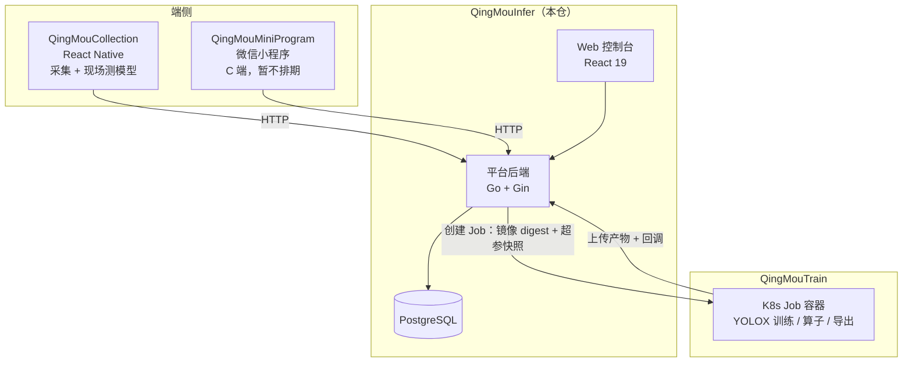

# QingMouInfer · 轻眸识刻基础训练平台

> 把「一堆乱图和视频」变成「一个能用的日期识别模型」的那张工作台。

---

## 我们在做什么

食品包装上都印着生产日期。

消费者想买之前看一眼新不新鲜，仓管入库想知道这批货还剩多久保质期，这些判断目前只能靠人眼——一箱一箱地翻，一个字一个字地看。看错一次，可能就是把临期货摆上了货架。

我们想做的事很简单：**拍一张照片，让机器把日期读出来。**

技术本身不难，一个目标检测模型就能把日期所在的区域框出来。真正难的是另外三件事：

**第一，没有现成的数据。** 你买不到「各种喷码字体、各种包装曲面反光、各种光照条件」的日期照片数据集。这东西只能自己去现场拍——去仓库、去货架、去流水线旁边。

**第二，标数据是个体力活。** 几千张照片一张张画框，枯燥、重复、容易出错。如果工具不趁手，人会在第三天就放弃，然后整个项目停在那里。

**第三，模型要反复调。** 补一批数据、改一组超参、再训一版——这个循环一天要跑好几遍。而每一次都必须能回答同一个问题：**这次和上次差在哪？** 是数据变了，还是参数变了，还是只是随机种子不一样？

轻眸识刻就是为这三件事造的基建。它不发明算法，它只是让上面这个循环转得快、转得稳、转得可追溯。

---

## 这个仓在做什么

整套系统分成三个仓：**人怎么用**（本仓）、**模型怎么训**（[QingMouTrain](https://github.com/QingMouFoodDate/QingMouTrain)）、**数据怎么采**（[QingMouCollection](https://github.com/QingMouFoodDate/QingMouCollection)）。

本仓是那个**人每天要打开的地方**。

它是 Web 控制台加一个后端服务，跑在一台机器上。你在这里把照片拖进来、把日期框出来、点一下开始训练、看着曲线往上涨、最后把模型导出去。所有"人要做决定"的环节都在这里，所有"机器自己跑"的环节都在另外两个仓。

换句话说：

- 本仓管**控制面**——谁在什么时候、用哪批数据、哪组参数、在哪台机器上、起了什么任务。
- [QingMouTrain](https://github.com/QingMouFoodDate/QingMouTrain) 管**执行面**——任务真的跑起来之后，容器里面发生的一切。

这条边界很重要，它决定了后面所有代码该写在哪个仓：**跑在服务端进程里的逻辑属于本仓，跑在训练容器里的逻辑属于 QingMouTrain。**



---

## 为什么要有这么一个平台

有人会问：直接写脚本不行吗？

第一版确实可以。但很快会遇到几个问题，而且它们都不是"写更多脚本"能解决的：

**数据会失去归属。** 图片散落在手机、硬盘、聊天记录里，三个月后没人记得哪张图属于哪一批、是不是已经标过了。于是只能重标一遍。

**标注会变成黑盒。** 谁标了多少、标得对不对、还剩多少没标——全靠数文件。标错的地方会被当成正确答案喂进模型，而模型会很忠实地学会错误。

**训练会失去记忆。** 那个效果特别好的模型，是用哪批数据、哪组超参、哪个版本的代码训出来的？没人说得清。于是"复现"变成了"重试"，运气好能撞回来，运气不好就永远丢了。

**指标会骗人。** 同一包食品连拍十张，如果按图片随机切成训练集和验证集，这十张会同时出现在两边。模型"见过"验证集，mAP 看着很漂亮，一上线就崩。这类错误肉眼看不出来，必须靠工具在切分的时候就拦住。

平台存在的意义，就是把上面这四件事变成**系统保证**，而不是"希望大家记得"。

---

## 功能范围

### 一期做这些

| 区域 | 能力 |
| :--- | :--- |
| **数据集** | 本地上传 / 压缩包导入 / 标准格式（COCO·YOLO·VOC·LabelMe）导入 / 视频抽帧；图库浏览与筛选；**自动体检**（损坏、重复、近重复、无目标、尺寸异常）；**数据集版本**（不可变快照 + 按"同一包装"分组切分）；检索；导出 COCO |
| **标注** | 标注台（矩形框、快捷键、自动保存、乐观锁防覆盖）；类别体系（颜色、快捷键、重命名零回填） |
| **训练** | 计算节点视图；镜像登记（**以 digest 固定**）；任务提交与排队；k3s Job 下发；心跳与看门狗；实时日志与指标曲线 |
| **模型** | 模型仓库与**血缘**（数据版本 + 超参 + 镜像 digest + 代码版本）；在线试跑；误检一键归档回待标注池 |
| **系统** | 登录与单管理员；统一错误码 |

### 一期不做这些

不是不重要，是**现在做没有意义**——等真正用起来、真正觉得缺了，再补也不迟。

- ❌ 四角色权限矩阵、审计日志哈希链、告警规则引擎 —— 两三个人用，一个账号就够
- ❌ 采集项目 / SOP / 派单 / 验收 / 绩效 —— 没有多人协作，这套作业链不成立
- ❌ 标注派单、双标一致性、质检返工 —— 自己标自己的，不需要这些
- ❌ 可视化流水线画布 —— 数据到模型的链路本来就固定，不需要"自由编排"
- ❌ 模型服务灰度、回滚、调用统计 —— 还没有一天要上十次线的规模

> 完整范围依据见 [SCOPE.md](https://github.com/QingMouFoodDate/QingMouPRD/blob/main/SCOPE.md)。

---

## 技术栈，以及为什么是它们

| 层 | 选型 | 为什么 |
| :--- | :--- | :--- |
| 后端 | **Go + Gin** | 调度、并发、文件流转是主战场；Go 的并发模型写这些最省心，部署就一个二进制 |
| 数据库 | **PostgreSQL** | 数据实体的关系性强（数据集↔版本↔样本↔标注↔模型），而且要用到部分唯一索引、JSONB 这些能力 |
| 对象存储 | **本地目录 / MinIO** | 单机起步，先用本地目录跑通；需要多机或容量扩展时换成 S3 兼容，代码不用改 |
| 训练调度 | **k3s / K8s Job** | 训练要 GPU、要隔离、要能挂掉重启。这本来就是 K8s 解决的问题，不必自己造 |
| 前端 | **React 19 + TypeScript + Vite** | 标注器是核心界面，需要成熟的 Canvas、虚拟滚动、快捷键生态 |

**刻意不做的事**：不拆微服务、不上 Kafka、不引入 Redis 集群。这些在 2~3 人的规模下**不产生任何价值，只产生运维负担**。等真的撞到瓶颈了，再拆也不晚。

---

## 核心数据实体

| 实体 | 说明 |
| :--- | :--- |
| `Dataset` / `DatasetVersion` | 数据集与**不可变版本快照**；版本是血缘的挂载点 |
| `DatasetVersionItem` | 版本成员：`sample_id` / `split` / `group_key`（快照） |
| `DataSample` | 单条数据（一张图或一帧）；`group_key` 是真源 |
| `ManagedFile` | 文件统一抽象；`owner_type` 固定 8 值，**一个物理文件只登记一条** |
| `LabelClass` / `Annotation` | 类别与标注（原图归一化坐标） |
| `TrainTask` | 训练任务；状态机 + `attempt` 重试，**不引入 TrainRun** |
| `Model` / `ModelVersion` | 模型与版本；落库时写死血缘，此后不可回写 |

---

## 规划目录结构

```text
QingMouInfer/
├── cmd/
│   └── server/              # 服务入口
├── internal/
│   ├── api/                 # Gin 路由与 handler
│   ├── domain/              # 领域实体（纯净 struct，不依赖框架）
│   ├── service/             # 业务逻辑
│   ├── store/               # PostgreSQL 持久化
│   ├── storage/             # 对象存储抽象（本地 / S3）
│   ├── scheduler/           # k3s Job 下发与看门狗
│   └── worker/              # 缩略图、抽帧、预检等后台任务
├── migrations/              # 数据库迁移
├── web/                     # React 19 + Vite 控制台
├── deploy/
│   └── docker-compose.yml
└── README.md
```

---

## 跨仓契约

本仓与另外两个仓之间的接口是**唯一事实来源**。任何一方改动，必须同步另一方——否则就会出现"平台以为传的是 A，容器以为收的是 B"这类最难查的问题。

### 与 QingMouTrain：Job 规约

| 项 | 约定 |
| :--- | :--- |
| 触发 | 创建 K8s Job，GPU 以 `resources.limits: nvidia.com/gpu` 声明 |
| 镜像 | **固定 image digest**（不是 tag），`imagePullPolicy: IfNotPresent` |
| 入参 | 超参快照（`params_hash`）+ 数据物化路径 + 输出目录 + `attempt` |
| 超参传递 | 由快照生成**白名单化**的 `exp_override.py` 与只读 `train_args.json` |
| 产物 | 输出目录 `YOLOX_outputs/<experiment_name>/`，文件名固定 |
| 出站 | 容器内上传对象存储后回调本仓；幂等键 `(train_task_id, attempt)` |
| 失败分工 | 容器崩溃 → K8s `restartPolicy`；Pod 终态 Failed → 平台按 `attempt` 重试 |

### 与端侧：HTTP 契约

上传链路的权威定义在**本仓**（`UploadSession` / `UploadChunk` / `ManagedFile`），客户端只负责实现；模型下发由本仓提供清单与预签名 URL，端侧校验 sha256 后缓存。

---

## 快速开始

```bash
# 依赖：Go 1.23+、Node 20+、PostgreSQL 16+、Docker
git clone git@github.com:QingMouFoodDate/QingMouInfer.git
cd QingMouInfer

# 一键起（含数据库与对象存储）
docker compose -f deploy/docker-compose.yml up -d

# 后端
go run ./cmd/server

# 前端
cd web && npm install && npm run dev
```

---

## 相关文档

仓库里只放代码，产品设计与全部决策依据在 [QingMouPRD](https://github.com/QingMouFoodDate/QingMouPRD)：

| 文档 | 内容 |
| :--- | :--- |
| [PLAN.md](https://github.com/QingMouFoodDate/QingMouPRD/blob/main/PLAN.md) | 产品形态一页 + Issue 清单 |
| [SCOPE.md](https://github.com/QingMouFoodDate/QingMouPRD/blob/main/SCOPE.md) | 范围界定：必做 / 工程约束 / 收敛项 |
| [REPOS.md](https://github.com/QingMouFoodDate/QingMouPRD/blob/main/REPOS.md) | 仓库地图与跨仓契约 |
| [PRD.md](https://github.com/QingMouFoodDate/QingMouPRD/blob/main/PRD.md) | 各模块详细需求 |

---

## License

内部项目，未经许可不得外传。
