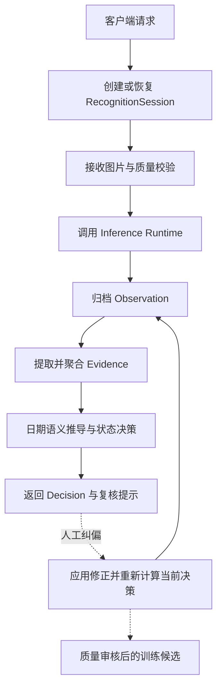
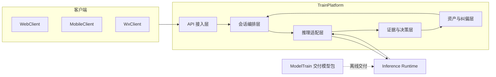

# TrainPlatform · 轻眸识刻业务与数据中枢

> 面向多端客户端的识别会话编排、推理适配、证据聚合与标示状态决策平台

TrainPlatform 目标定位为系统的在线业务运行时和数据中枢，统一承接 WebClient、MobileClient 与 WxClient 的请求。平台规划负责会话生命周期、图片资产管理、推理服务调用、证据聚合、日期语义推导和人工纠偏，不直接承担深度学习模型训练。

## 当前状态

当前仓库主要维护在线业务后端与业务编排平台的职责、接口和实现规划，
当前文档不足以证明已有可运行业务实现。具体能力以代码、测试和发布记录为准；
模型前向推理由独立 Inference Runtime 负责。

---

## 一、产品定位与职责边界

### 1. 核心职责

- **统一 API 接入**：为三类客户端提供会话、图片、结果、纠偏和模型元数据接口；
- **识别会话编排**：管理一件食品的多图上传、增量识别、状态变化和结果查询；
- **推理服务适配**：调用本地或远程 Inference Runtime，并将模型输出转换为统一的 `Observation`；
- **证据聚合与决策**：从机器观察值提取结构化证据，结合日期规则输出标示状态和复核状态；
- **样本与纠偏管理**：保存原始机器结果与人工修正的对应关系，并将通过质量审核的难例标记为训练候选；
- **模型版本管理**：记录已发布模型的版本、校验和与运行时引用，不直接加载模型文件执行前向推理。

### 2. 不负责的内容

- 不负责深度学习网络组网、训练调优和消融实验；
- 不在客户端或业务平台重复实现模型内部算法；
- 不把人工纠偏样本未经审核直接加入训练集；
- 不向客户端直接暴露数据库、模型文件系统或内部存储路径。

`ModelTrain` 负责离线算法研发和模型交付；`Inference Runtime` 负责加载已发布模型并执行在线推理；TrainPlatform 负责管理模型版本引用、调用推理服务和处理业务结果。

---

## 二、端到端业务流程



系统按以下领域实体组织数据：

| 实体 | 说明 |
| :--- | :--- |
| `RecognitionSession` | 一件食品的一次多图识别会话 |
| `Image` | 会话中上传的单张包装图像 |
| `Observation` | 推理服务返回的检测框、置信度和 OCR 转录等机器观察值 |
| `Evidence` | 从观察值提取的生产日期、到期日、保质期或储存条件等结构化证据 |
| `Decision` | 标示期限状态、复核状态和引导提示组成的业务决策 |

平台输出的是包装上的**标示状态**，不替代食品安全检测，也不直接判断食品是否绝对安全或适宜食用。

---

## 三、运行时架构



Inference Runtime 可以与 TrainPlatform 部署在同一台机器，也可以作为独立服务部署。部署形态变化不应改变客户端 API、领域实体和模型输入输出契约。

---

## 四、核心模块

| 模块 | 主要职责 |
| :--- | :--- |
| API 接入 | 参数、图片格式/大小、统一响应、错误码、`request_id`、跨域、超时、限流和访问控制 |
| 会话编排 | 会话创建/恢复/查询、多图追加、状态和幂等处理；新增图片或纠偏后重新聚合证据 |
| 推理适配 | 调用 Runtime，校验模型引用和 Observation 结构，处理超时/不可用/格式异常并记录版本与耗时 |
| 证据与决策 | 提取并聚合日期、保质期和储存条件，区分缺失/冲突/低置信度，依据日期规则生成状态和提示 |
| 资产与纠偏 | 关联图片、Observation、Evidence、Decision，保存机器结果与人工修正，管理质量门禁和训练候选 |

平台不向外部暴露内部文件路径、数据库或基础设施细节；模型文件、哈希和张量规格由 Inference Runtime 校验。

---

## 五、会话与业务状态

### 1. 会话处理状态

```text
AWAITING_INPUT
RECEIVING_IMAGES
PROCESSING
PARTIAL_RESULT
COMPLETED
NEEDS_REVIEW
FAILED
EXPIRED
```

### 2. 标示状态

```text
WITHIN_MARKED_PERIOD
NEAR_EXPIRY
PAST_MARKED_PERIOD
UNDETERMINED
```

### 3. 复核状态

```text
EVIDENCE_COMPLETE
INFORMATION_MISSING
EVIDENCE_CONFLICT
LOW_CONFIDENCE
```

会话处理状态表示系统处理进度；标示状态和复核状态表示业务决策结果。推理失败不应被伪装成 `UNDETERMINED`，接口也不应在失败时返回成功形状的结果。

---

## 六、跨仓契约

平台必须遵守以下系统级契约：

- 客户端接口：[API 接口契约](https://github.com/QingMouFoodDate/ProjectPRD/blob/main/contracts/API.md)
- 模型输入输出与交付包：[模型交付规约](https://github.com/QingMouFoodDate/ProjectPRD/blob/main/contracts/MODEL.md)
- 数据实体：[数据模型](https://github.com/QingMouFoodDate/ProjectPRD/blob/main/contracts/DATA.md)
- 数据质量：[数据质量规范](https://github.com/QingMouFoodDate/ProjectPRD/blob/main/standards/DATA_QUALITY.md)

主要接口类别包括：

- `POST /api/v1/sessions`：创建识别会话；
- `POST /api/v1/sessions/{session_id}/images`：上传图片并增量识别；
- `GET /api/v1/sessions/{session_id}`：获取完整会话、证据和决策；
- `POST /api/v1/sessions/{session_id}/correction`：提交人工纠偏，立即更新当前会话决策；训练候选资格另行审核；
- `GET /api/v1/models/latest`：查询移动端可用的模型元数据。

上传、纠偏和重试流程应支持幂等处理；多图追加后必须重新聚合证据，不能只返回孤立的单图结果。

---

## 七、数据与安全边界

- 对上传文件执行扩展名、媒体类型、内容和大小校验；
- 通过访问控制限制会话、图片和纠偏记录的读取范围；
- 原始图片和模型资产使用受控存储，不在公开响应中暴露物理路径；
- 业务数据库保存元数据和关联关系，图片与模型文件由独立资产存储管理；
- 日志不记录原始图片、完整敏感文本或不必要的用户信息；
- 校验请求使用的模型版本引用与 Runtime 返回版本一致；模型文件、哈希和张量规格校验由 Inference Runtime 负责；
- 对失败任务、过期会话和临时文件提供清理策略；
- 具体存储位置由部署环境配置，不在公开文档中固定本地目录。

---

## 八、提议工程结构

以下目录是实现建议，不代表当前仓库已经具备对应文件。

```text
TrainPlatform/
├── README.md
├── requirements.txt / pyproject.toml
├── .env.example
└── app/
    ├── api/                 # REST 路由和请求控制器
    ├── core/                # 配置、认证、跨域和异常处理
    ├── models/              # 持久化实体和数据表映射
    ├── schemas/             # 请求响应模型和契约校验
    ├── services/            # 会话、推理代理和纠偏服务
    ├── engine/              # 日期语义与标示状态决策
    └── storage/             # 资产存储和质量门禁适配
```

以上目录以 Python 实现为例；采用 Go 路线时，应按对应工程规范调整目录和依赖。无论采用哪种实现语言，API、领域实体、状态枚举和跨仓契约保持稳定。

---

## 九、技术选型

候选路线为 Python FastAPI + SQLAlchemy + Pydantic，或 Go + Gin/Go-Zero + GORM；元数据存储可按规模选择 SQLite 或 PostgreSQL。选型不改变客户端 API、日期规则、领域实体和模型交付契约。

---

## 十、相关文档

- [系统需求](https://github.com/QingMouFoodDate/ProjectPRD/blob/main/REQUIREMENTS.md)
- [系统架构](https://github.com/QingMouFoodDate/ProjectPRD/blob/main/ARCHITECTURE.md)
- [API 接口契约](https://github.com/QingMouFoodDate/ProjectPRD/blob/main/contracts/API.md)
- [数据模型](https://github.com/QingMouFoodDate/ProjectPRD/blob/main/contracts/DATA.md)
- [模型交付规约](https://github.com/QingMouFoodDate/ProjectPRD/blob/main/contracts/MODEL.md)
