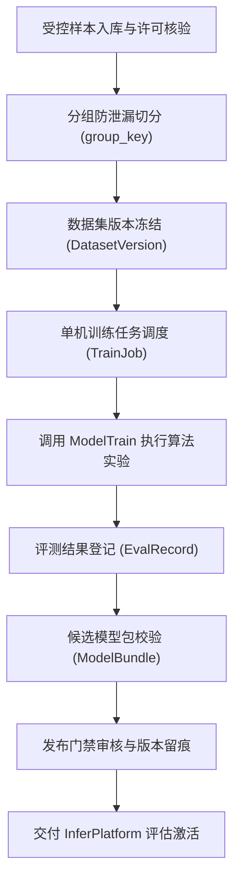
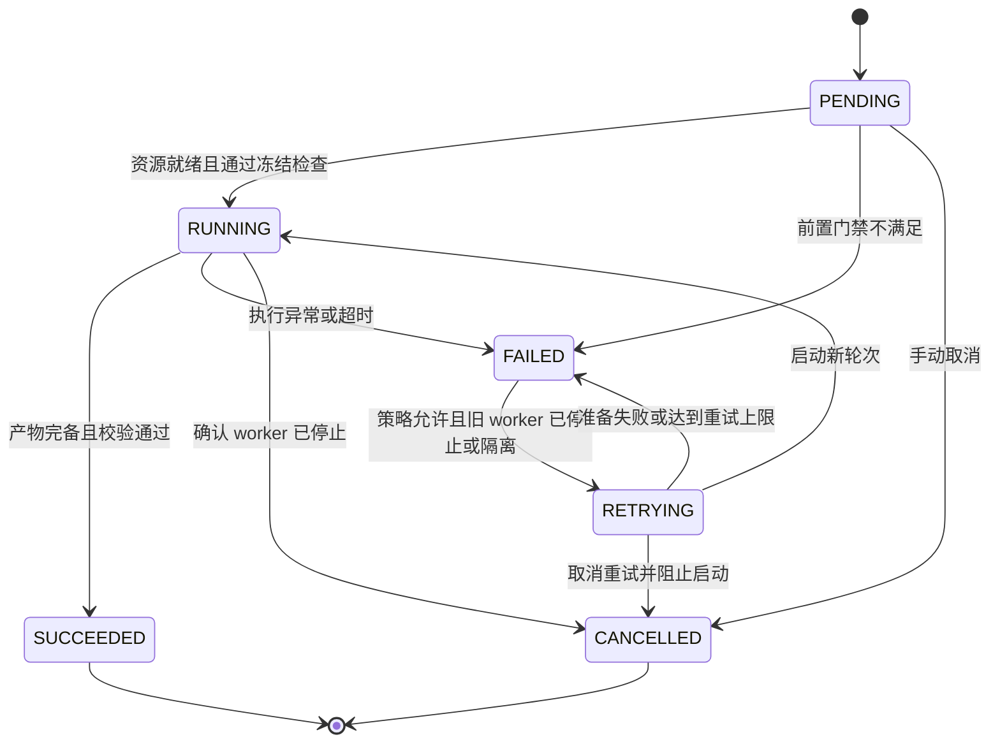
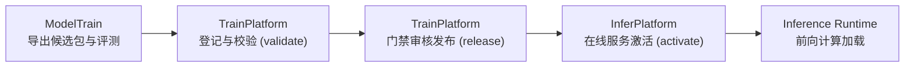

# TrainPlatform · 轻眸识刻集成调度训练平台

> 面向数据资产治理、标注质量审核、单机训练调度与模型生命周期的中枢服务仓
>
> **工程状态**：M0 待实现 · 当前仅有 README，无业务代码

TrainPlatform 负责离线侧“数据-实验-模型”全周期治理，承担样本合规准入、标注审核留痕、数据集版本冻结与单机训练调度职责；在线 API、实时会话与日期推导由 InferPlatform 承接。

---

## 工程状态与边界说明

| 维度 | 说明 |
| :--- | :--- |
| **当前阶段** | M0 待实现；六个实现仓当前均仅有 README，本仓维护离线治理与调度设计 |
| **实现范围** | M0 先由 ModelTrain 实现单机 CLI；本仓可用手工记录审核样本、冻结版本与候选包，管理服务随后建设 |
| **契约基准** | 数据结构与调度规约以 [contracts/DATA.md](https://github.com/QingMouFoodDate/ProjectPRD/blob/main/contracts/DATA.md)、[contracts/TRAINING.md](https://github.com/QingMouFoodDate/ProjectPRD/blob/main/contracts/TRAINING.md) 与 [contracts/MODEL.md](https://github.com/QingMouFoodDate/ProjectPRD/blob/main/contracts/MODEL.md) 为准 |

项目保留 7 个项目仓库及组织 `.github` 仓，共 8 仓；MobileClient、WxClient 暂缓实现。下文为设计规划，所列模块与目录尚未创建。

---

## 一、平台核心职责与系统边界

### 1. 核心负责内容

- **样本资产治理**：登记受控样本，核验来源与许可凭证，执行 SHA-256 内容校验与删除保护；
- **数据集切分冻结**：建立不可变快照版本，严格基于 `group_key` 分组切分，严防连拍与近重复样本跨集合泄漏；
- **标注审核与返工**：维护标注作业生命周期，记录修订历史与质量审核留痕；
- **单机任务调度**：管理单机训练排队、资源预检、任务状态迁移跟踪与看门狗监控；
- **评测与模型治理**：登记实验评测记录，维护模型包不可变血缘链路，执行格式校验与发布门禁。

### 2. 系统协作与设计约束

- **算法执行隔离**：不自行编写神经网络代码或算子，模型训练、局部识别与消融实验统一归属 ModelTrain；
- **在线业务解耦**：不直接向客户端暴露接口，不维护用户实时会话，推理运行时归属 InferPlatform；
- **数据回流约束**：线上纠偏即时更新业务；获训练用途授权的记录经本仓独立审核后才取得训练候选资格，不自动入集、训练或发布。

---

## 二、数据流与治理流程



---

## 三、核心领域实体

系统统一采用上位契约定义的核心实体标准：

| 实体名称 | 设计职责 |
| :--- | :--- |
| `SampleAsset` | 受控样本资产，记录获取渠道、许可凭据、内容哈希与质量审核记录 |
| `DatasetVersion` | 冻结且不可变的数据集版本快照，完整追溯父版本血缘 |
| `DatasetVersionItem` | 数据集成员关系，关联样本、标注修订版本、切分标识与防泄漏分组键 |
| `LabelTask` | 标注任务单元，划定特定样本范围与目标字段标注规格 |
| `Annotation` | 结构化标注成果，保留标注人员、时间戳与不可覆盖的修订历史 |
| `LabelReview` | 标注质量审核记录，留存审核结论、返工原因与责任链条 |
| `TrainJob` | 单机训练作业，维护配置版本、执行状态、重试次数与产物索引 |
| `EvalRecord` | 评测记录快照，记录指标表现、评测集版本、运行环境与超参 |
| `ModelBundle` | 标准模型交付包元数据，维护格式完整性、文件校验和与发布血缘 |
| `ManagedFile` | 物理资产登记载体，基于内容哈希去重并提供受控删除防护 |

---

## 四、 数据准入与防泄漏约束

### 1. 最新受控数据资产与来源构成

受控样本库已完成全量肉眼审判与质量网关自动化检验，资产状态以 [DATA 第二节](https://github.com/QingMouFoodDate/ProjectPRD/blob/main/contracts/DATA.md#二离线-sampleasset) 为准：

| 资产层级 / 受控命名 | 物理原图量 | 治理与准入状态 | 质检与血缘保障 |
| :--- | :---: | :--- | :--- |
| **全量主基准库 (MasterBenchmark)** | **1617** | **已全量冻结**：8:1:1 科学分层切分（Train 1293, Val 162, Test 162） | SHA-256 100% 唯一无重复，基于 group_key 严格防泄漏，通过完整性与质量门禁 |

> **数据来源构成**：网络搜集与定向采图 1307 张（80.8%），线下生活与商超实拍 310 张（19.2%）；打码工艺覆盖油墨点阵（77.8%）、激光刻印（10.2%）、热敏标签（6.6%）及钢印压痕等主流工况。

### 2. 准入与防泄漏治理

1. **准入门禁与分级隔离体系**：
   - 标准正样本遵循 [数据质量规范](https://github.com/QingMouFoodDate/ProjectPRD/blob/main/standards/数据质量规范.md) 的六类排除规则；负样本、难例与待审纠偏记录独立标记、审核和隔离；
   - 按训练、评测、公开展示与再次分发核验来源许可；未审样本不得冻结，内容去重仍保留各项来源与许可记录；
   - 逐张查看完整分辨率原图，核对检测框、可见 OCR 原文与日期语义，禁止拼图粗审或用推导补造真值。
2. **防泄漏切分原则 · 8:1:1 科学分层切分**：
   - 严格遵循 **80% 训练集 (1293 张) / 10% 验证集 (162 张) / 10% 测试集 (162 张)** 的科学分层切分规范；
   - **`group_key` 严格防泄漏**：同一实物、采集会话、连拍、确认的近重复及原图派生图强制绑定唯一 `group_key`，整组必须全量划入 `train / val / test` 之一，杜绝任何同源特征跨集合泄漏；
   - 测试集作为独立盲测基准，严禁参与模型选优、阈值搜索、字表提取或量化校准。
3. **版本冻结不可变与派生血缘**：
   - 数据清单与标注版本一经冻结即固化为只读快照，绑定许可、审核、哈希与切分；清洗或增补派生新版本并保留父版本关系；
   - 先分组切分再生成训练派生图，副本继承原组与 split；测试集不参与阈值、字表、纠错权重、模型选优或量化校准。

研究数据还需记录字符可读性、裁剪截断和日期类型的标注依据，并保留未见商品、设备及拍摄条件的独立测试关系。用于可靠性校准和处理动作选择的数据与最终测试分开，不能从同源图片或测试结果反向调策略。

日期起算与临期配置由 InferPlatform 按候选规则管理，拟通过 decision.v2 的 calculation_profile_id 关联不可变计算依据。标注保留包装原文与来源，不把派生日期或默认起算方式补成视觉真值；新契约统一后接入，旧记录保持原版本。

---

## 五、单机调度状态机规范

本仓组装任务并核验执行事件，ModelTrain 执行算法。任务模式沿用 `TRAIN / EVALUATE / EXPORT`，消融通过任务与配置组合组织；输入与事件规则见 [TRAINING](https://github.com/QingMouFoodDate/ProjectPRD/blob/main/contracts/TRAINING.md)。单机任务采用以下状态迁移：



- 重试递增 `attempt`，以 `(train_job_id, attempt)` 幂等登记并隔离输出；更换数据、代码、配置、环境或父包须新建任务；
- 重复回调只登记一次；迟到旧 attempt、非法顺序及终态后事件仅留审计，不改变当前状态或登记为当前产物；
- 看门狗记录失败后，须确认旧 worker 停止或其计算与写入权限已隔离才能重试，无法确认时转人工；运行中取消须确认停止；
- `SUCCEEDED` 仅表示执行与必需产物校验通过，指标达标及发布另行审核；失败或不完整产物保持隔离。

---

## 六、模型生命周期与发布门禁

模型包发布遵循跨仓流转链路：



- 候选模型包按 [contracts/MODEL.md](https://github.com/QingMouFoodDate/ProjectPRD/blob/main/contracts/MODEL.md) 成套交付，核验文件哈希、独立评测、真实加载与 smoke；同版异包拒绝，内容与血缘不可覆盖；
- `register / validate / release` 由本仓治理，审批及授权追加记录；发布不等于 active，InferPlatform 另行核验外部授权、兼容性并控制激活与回滚。

---

## 七、提议工程目录结构

M0 采用单机与手工治理记录，先满足审核、追溯与资源隔离；容器作业、Kubernetes 调度等后续方案按作业量和维护成本评审。

```text
TrainPlatform/                  # 训练治理与调度平台仓库
├── README.md                   # 平台职责、架构与数据规范说明
├── requirements.txt            # Python 核心依赖清单
├── .env.example                # 基础环境配置参考
└── app/                        # 业务应用核心逻辑
    ├── api/                    # 内部数据管理与控制接口
    ├── samples/                # 样本资产准入与许可审计
    ├── datasets/               # 数据集版本冻结与防泄漏切分
    ├── labeling/               # 标注任务调度与质检留痕
    ├── jobs/                   # 单机训练作业调度与看门狗
    ├── evaluation/             # 算法评测结果追溯与指标登记
    ├── models/                 # 模型生命周期血缘与发布门禁
    ├── storage/                # 受控物理文件索引与哈希去重
    └── core/                   # 全局配置、异常处理与审计日志
```

---

## 八、相关文档

- [需求规格](https://github.com/QingMouFoodDate/ProjectPRD/blob/main/需求规格.md)
- [系统架构](https://github.com/QingMouFoodDate/ProjectPRD/blob/main/系统架构.md)
- [开发路线](https://github.com/QingMouFoodDate/ProjectPRD/blob/main/开发路线.md)
- [数据模型](https://github.com/QingMouFoodDate/ProjectPRD/blob/main/contracts/DATA.md)
- [训练调度规范](https://github.com/QingMouFoodDate/ProjectPRD/blob/main/contracts/TRAINING.md)
- [模型交付规约](https://github.com/QingMouFoodDate/ProjectPRD/blob/main/contracts/MODEL.md)
- [数据质量规范](https://github.com/QingMouFoodDate/ProjectPRD/blob/main/standards/数据质量规范.md)
- [工程协作指南](https://github.com/QingMouFoodDate/ProjectPRD/blob/main/standards/工程协作指南.md)
- [研究现状](https://github.com/QingMouFoodDate/ProjectPRD/blob/main/references/研究现状.md)


