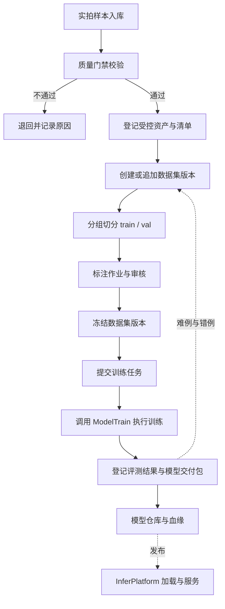

# TrainPlatform · 轻眸识刻集成调度训练平台

> 面向样本资产、数据集版本、标注作业与训练任务调度的内部平台

TrainPlatform 是模型的**生产车间**：它管理样本从入库、清洗、标注到切成训练集/验证集的全过程，负责把训练任务派发给算法仓库并跟踪执行，最后把产出的模型登记进模型仓库并记录完整血缘。

它**对内**服务算法与数据工作，**不对外**提供业务 API。面向客户端的识别服务由 `InferPlatform` 承担。

---

## 一、定位与职责边界

### 1. 负责内容

- **样本资产管理**：接收实拍样本、校验质量门禁、登记受控资产并维护清单；
- **数据集版本管理**：将样本组织为不可变的数据集版本，冻结后不允许原地修改；
- **切分与防泄漏**：按商品、包装批次或连拍分组切分训练集与验证集，防止同源样本跨集合；
- **标注作业管理**：维护标注任务、标注结果、审核状态与标注版本；
- **训练任务调度**：接收训练请求，组装数据与配置，调用算法仓库执行并跟踪状态；
- **评测与实验记录**：登记评测结果、实验配置与对照关系，保证结论可复现；
- **模型仓库与血缘**：登记模型交付包版本，记录其对应的数据集版本、训练配置与代码版本。

### 2. 不负责内容

- 不实现神经网络结构、训练算法与推理前向计算，这些属于 `ModelTrain`；
- 不提供面向客户端的产品 API、识别会话与标示状态决策，这些属于 `InferPlatform`；
- 不在线加载和调用模型对外服务；
- 不向使用方暴露数据库结构、内部存储路径或部署细节；
- 不在公开仓库中提交原始图片、模型权重或其他敏感数据；
- **不引入 Kubernetes、微服务编排或企业级单点登录**，项目在单机闭环阶段明确拒绝这类复杂度。

### 3. 与其余仓库的分工

| 事项 | TrainPlatform | ModelTrain | InferPlatform |
| :--- | :--- | :--- | :--- |
| 样本入库与质量门禁 | 负责 | 不负责 | 不负责 |
| 数据集版本与切分 | 负责 | 只读消费 | 不负责 |
| 标注作业与审核 | 负责 | 只读消费标注结果 | 不负责 |
| 训练任务调度 | 负责 | 被调度 | 不负责 |
| 模型训练与导出 | 不负责 | 负责 | 不负责 |
| 模型登记与血缘 | 负责 | 交付模型包 | 只读取已发布模型 |
| 对外 API 与识别会话 | 不负责 | 不负责 | 负责 |
| 模型前向推理 | 不负责 | 不负责 | 负责 |

---

## 二、端到端业务流程



关键原则：**数据集版本冻结后不可变**；任何补充、清洗或标注修正都产出**新版本**，而不是覆盖旧版本。这是"同一份数据能复现同一个模型"的前提。

---

## 三、核心领域实体

| 实体 | 说明 |
| :--- | :--- |
| `SampleAsset` | 单条受控样本资产，字段遵循 `contracts/DATA.md`，含 `sha256`、`phash` 与标注转录字段 |
| `DatasetVersion` | 数据集版本，不可变快照；冻结后只读 |
| `DatasetVersionItem` | 版本成员关系：`version_id`、`sample_id`、`split`、`group_key` |
| `LabelTask` | 标注作业，指定样本范围与标注类型 |
| `Annotation` | 单条标注结果，记录标注人、时间与修订号 |
| `LabelReview` | 标注审核记录，决定标注结果是否可用于训练 |
| `TrainJob` | 训练任务，记录配置、状态、重试次数与产出引用 |
| `EvalRecord` | 评测记录，关联数据集版本、模型包与指标 |
| `ModelBundle` | 模型交付包版本，字段遵循 `contracts/MODEL.md` |
| `ManagedFile` | 文件统一登记实体，确保同一物理文件只登记一条记录 |

---

## 四、数据集版本与切分

### 1. 版本不可变

数据集版本一经冻结即只读。冻结动作锁定三件事：样本清单、切分结果、标注版本。

冻结后若需补充样本或修正标注，必须新建版本。版本之间通过 `parent_version` 形成链，支持追溯"这一版比上一版多了什么"。

### 2. 分组切分与防泄漏

这是本平台**最重要的工程约束**。

同一件商品的连拍、同一包装批次的重复拍摄、同一场景的相似照片，如果被随机切分，会同时出现在训练集与验证集。模型"见过"验证集，指标虚高，上线后表现崩塌。这类错误肉眼不可见，必须在切分阶段由系统拦截。

实现要求：

- 每条样本记录 `group_key`，取值优先级为：同一商品批次 > 同一拍摄会话 > 同一商品 > 感知哈希近重复簇；
- 切分以 `group_key` 为单位整体分配，**同一 `group_key` 不得跨 `split`**；
- 违反该约束的切分请求必须被拒绝，并列出冲突的分组；
- 切分比例允许小幅偏离目标，**分组完整性优先于比例精确**。

### 3. 切分结果校验

版本冻结前必须通过校验，任一不通过即拒绝冻结：

| 校验项 | 要求 |
| :--- | :--- |
| 分组完整性 | 同一 `group_key` 不跨 `split` |
| 样本非空 | 训练集与验证集均非空 |
| 标签覆盖 | 标注审核通过的样本才可进入训练集 |
| 清单一致 | 清单行数与实际登记资产一一对应 |

---

## 五、标注作业

标注作业面向包装上的三类核心文本实体，与 `standards/DATA_QUALITY.md` 保持一致：

- 生产日期 `MFG`；
- 到期日 `EXP`；
- 保质期说明 `SHELF_LIFE`。

作业流程：创建标注作业，分配样本范围，标注、审核、打回返工。标注结果必须记录**标注人、时间与修订号**，同一张图被重新标注时保留历史版本，不覆盖。

审核不通过的标注不得进入训练集。人工纠偏产生的样本，必须先通过质量审核才能成为训练候选，不允许直接从线上纠偏流入训练数据。

---

## 六、训练任务与调度

### 1. 执行方式

平台在**单机**环境下调度训练任务：组装数据集版本、配置与代码版本，调用 `ModelTrain` 的入口执行，并跟踪其状态与产出。

**不引入 Kubernetes 或任务编排系统。** 单机闭环阶段，任务的排队、并发控制与失败重试由平台自身管理即可；引入编排系统只增加运维负担，不影响算法进度。

### 2. 任务状态

```text
PENDING
RUNNING
SUCCEEDED
FAILED
RETRYING
CANCELLED
```

状态迁移必须白名单化，非法迁移直接拒绝，避免任务卡在中间态无人处理。

### 3. 重试与幂等

- 一次任务的重试**只递增 `attempt`**，不新建任务实体；
- 任务产出登记使用 `(train_job_id, attempt)` 作为幂等键，重复回调只登记一次；
- 超时未上报状态的任务由看门狗判定为失败并按策略重试，超过上限则标记为最终失败；
- 需要续训时可从已保存的 checkpoint 继续，而不是从头重跑。

### 4. 并发控制

单机环境下同时运行的训练任务数量受限，超出的任务排队等待。GPU 资源不足时应在**任务开始前**拒绝，而不是跑到一半失败。

---

## 七、模型仓库与血缘

每个模型交付包都必须能回答四个问题：**用哪版数据训的、用什么配置训的、用哪版代码训的、指标是多少**。

登记时一次性写入以下字段，此后不可回写：

| 字段 | 说明 |
| :--- | :--- |
| `dataset_version_id` | 训练所用数据集版本 |
| `train_config_hash` | 训练配置的规范化哈希 |
| `code_commit` | 算法仓库的代码版本 |
| `runtime_version` | 运行环境版本 |
| `eval_record_id` | 关联的评测记录 |
| `parent_bundle_id` | 续训或微调的基础模型包 |

模型包状态遵循 `contracts/MODEL.md`，从候选到发布的流转必须留痕。

---

## 八、防静默数据损坏的硬约束

以下约束**没有界面**，但缺失会导致数据无声损坏，且发现时往往已不可追溯。它们不是可选优化，是平台的底线。

| 约束 | 要求 | 缺失后果 |
| :--- | :--- | :--- |
| 物理文件唯一登记 | 同一物理文件只登记一条 `ManagedFile`，其他位置一律外键引用 | 引用计数错乱，清理时删除仍在使用的文件 |
| 上传幂等 | 以 `sha256` 与文件大小判定重复，命中即复用 | 弱网重传导致资产重复、数据集被同一张图稀释 |
| 训练回调幂等 | 幂等键 `(train_job_id, attempt)` | 失败重试导致模型版本重复登记 |
| 版本不可变 | 数据集版本冻结后只读 | 血缘失效，历史模型无法复现 |
| 分组切分 | 同一 `group_key` 不跨 `split` | **指标虚高，上线崩溃** |
| 删除保护 | 被数据集版本或训练任务引用的资产不可删除 | 训练记录断链，无法追溯 |
| 状态机白名单 | 非法状态迁移直接拒绝 | 任务卡死或重复执行 |

统一错误码采用 `E<模块><序号>` 格式，跨模块引用必须使用真实错误码，不得自造同义码。

---

## 九、跨仓契约

平台必须遵守以下系统级契约：

- 数据实体与枚举：[数据模型](https://github.com/QingMouFoodDate/ProjectPRD/blob/main/contracts/DATA.md)
- 模型交付包结构：[模型交付规约](https://github.com/QingMouFoodDate/ProjectPRD/blob/main/contracts/MODEL.md)
- 样本与清单命名：[工程协作与规范指南](https://github.com/QingMouFoodDate/ProjectPRD/blob/main/standards/ENGINEERING.md)
- 数据准入与质检门禁：[数据质量规范](https://github.com/QingMouFoodDate/ProjectPRD/blob/main/standards/DATA_QUALITY.md)

与 `ModelTrain` 的接口是**任务级**的：平台提供数据集版本路径、训练配置与输出目录，算法仓库返回状态与模型交付包。平台不依赖算法仓库的内部实现，算法仓库不反向调用平台内部接口。

---

## 十、工程结构

```text
TrainPlatform/
├── README.md
├── requirements.txt
├── .env.example
└── app/
    ├── api/                 # 内部管理接口，仅对内提供
    ├── samples/             # 样本入库、质量门禁与资产登记
    ├── datasets/            # 数据集版本、切分与冻结校验
    ├── labeling/            # 标注作业、标注结果与审核
    ├── jobs/                # 训练任务排队、调度与状态跟踪
    ├── models/              # 模型仓库、血缘登记与发布流转
    ├── storage/             # 受控资产存储适配与文件登记
    └── core/                # 配置、异常与统一错误码
```

## 十一、技术选型

### 路线 A：Python FastAPI + SQLAlchemy + Pydantic

- *优势*：与算法仓库共享 Python 生态，数据版本、清单解析与切分逻辑可直接复用科学计算库；
- *适用场景*：项目当前阶段，团队以 Python 为主，训练与数据处理链路同构。

### 路线 B：Go + Gin + GORM

- *优势*：编译型交付、运行时依赖少，适合长期驻留的后台服务；
- *适用场景*：需要更高并发或更轻部署体积时。

元数据存储可选择 SQLite 或 PostgreSQL。技术路线不改变数据实体、切分约束与跨仓契约。

---

## 十二、相关文档

- [系统需求](https://github.com/QingMouFoodDate/ProjectPRD/blob/main/REQUIREMENTS.md)
- [系统架构](https://github.com/QingMouFoodDate/ProjectPRD/blob/main/ARCHITECTURE.md)
- [数据模型](https://github.com/QingMouFoodDate/ProjectPRD/blob/main/contracts/DATA.md)
- [数据质量规范](https://github.com/QingMouFoodDate/ProjectPRD/blob/main/standards/DATA_QUALITY.md)
- [推进路线](https://github.com/QingMouFoodDate/ProjectPRD/blob/main/ROADMAP.md)
