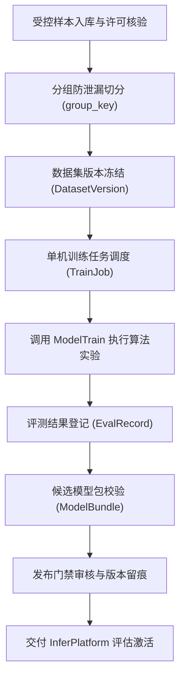
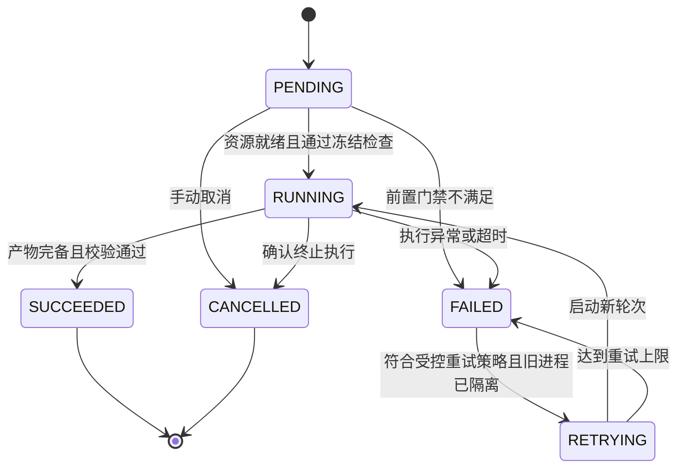
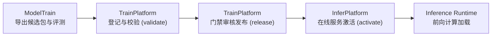

# TrainPlatform · 轻眸识刻集成调度训练平台

> 面向数据资产治理、标注质量审核、单机训练调度与模型生命周期的中枢服务仓
>
> **工程状态**：设计规范完备 · M0 单图闭环推进中 · 算法执行解耦至 ModelTrain · 在线服务解耦至 InferPlatform

TrainPlatform 负责离线侧“数据-实验-模型”全周期治理，承担样本合规准入、标注审核留痕、数据集版本冻结与单机训练调度职责；在线 API、实时会话与日期推导由 InferPlatform 承接。

---

## 工程状态与边界说明

- **当前阶段**：处于架构规范与 M0 核心原型攻坚阶段，本仓维护离线治理与调度规范；
- **实现范围**：M0 阶段优先通过 ModelTrain 单机 CLI 完成算法实验与候选包导出，平台级服务随 C0 演进逐步落地；
- **契约基准**：数据结构与调度规约严格绑定上位 [DATA.md](../ProjectPRD/contracts/DATA.md)、[TRAINING.md](../ProjectPRD/contracts/TRAINING.md) 与 [MODEL.md](../ProjectPRD/contracts/MODEL.md)。

---

## 一、平台核心职责与系统边界

### 1. 核心负责内容

- **样本资产治理**：登记受控样本，核验来源与许可凭证，执行 SHA-256 内容校验与删除保护；
- **数据集切分冻结**：建立不可变快照版本，严格基于 `group_key` 分组切分，严防连拍与近重复样本跨集合泄漏；
- **标注审核与返工**：维护标注作业生命周期，记录修订历史与质量审核留痕；
- **单机任务调度**：管理单机训练排队、资源预检、任务状态迁移跟踪与看门狗监控；
- **评测与模型治理**：登记实验评测记录，维护模型包不可变血缘链路，执行格式校验与发布门禁。

### 2. 系统协作与设计约束

- **算法执行隔离**：不自行编写神经网络代码或算子，模型训练、局部识别与消融实验统一归属 ModelTrain；
- **在线业务解耦**：不直接向客户端暴露接口，不维护用户实时会话，推理运行时归属 InferPlatform；
- **数据回流约束**：线上纠偏数据经离线合规审核与质量检验后，方可晋升为训练候选，杜绝标签自动污染。

---

## 二、数据流与治理流程



---

## 三、核心领域实体

系统统一采用上位契约定义的核心实体标准：

| 实体名称 | 设计职责 |
| :--- | :--- |
| `SampleAsset` | 受控样本资产，记录获取渠道、许可凭据、内容哈希与质量评分 |
| `DatasetVersion` | 冻结且不可变的数据集版本快照，完整追溯父版本血缘 |
| `DatasetVersionItem` | 数据集成人员关系，关联样本文件、切分集标识与防泄漏分组键 |
| `LabelTask` | 标注任务单元，划定特定样本范围与目标字段标注规格 |
| `Annotation` | 结构化标注成果，保留标注人员、时间戳与不可覆盖的修订历史 |
| `LabelReview` | 标注质量审核记录，留存审核结论、返工原因与责任链条 |
| `TrainJob` | 单机训练作业，维护配置版本、执行状态、重试次数与产物索引 |
| `EvalRecord` | 评测记录快照，记录指标表现、评测集版本、运行环境与超参 |
| `ModelBundle` | 标准模型交付包元数据，维护格式完整性、文件校验和与发布血缘 |
| `ManagedFile` | 物理资产登记载体，基于内容哈希去重并提供受控删除防护 |

---

## 四、数据准入与防泄漏约束

1. **来源与授权合规**：准入样本须具备清晰来源渠道、授权凭据与用途声明；凭据缺失或低质图像一律拒收。
2. **防泄漏切分原则**：以商品个体、批次、拍摄会话为聚类依据（`group_key`），同组样本完整归入训练集、验证集或测试集之一，严禁跨集合穿插；测试集严禁参与调参。
3. **版本冻结不可变**：样本清单、标注版本与划分规则一经冻结即成只读快照；清洗或增补须派生全新版本，严禁原地改写历史。

---

## 五、单机调度状态机规范

调度器采用白名单状态迁移机制，单机任务生命周期如下：



- 重试机制严格递增 `attempt` 计数，以 `(train_job_id, attempt)` 建立幂等追踪；
- 看门狗触发超时或异常时，确认旧进程释放且文件写入隔离后，方可触发下一轮执行。

---

## 六、模型生命周期与发布门禁

模型包发布遵循跨仓流转链路：



- 候选模型包必须完整包含上位 `MODEL.md` 所要求的全部权重、字典、预处理与 smoke 验证配置；
- 发布审核代表离线模型资产治理通过，不直接改写线上运行状态；在线激活与回滚决策由 InferPlatform 自主管控。

---

## 七、提议工程目录结构

```text
TrainPlatform/                  # 训练治理与调度平台仓库
├── README.md                   # 平台职责、架构与数据规范说明
├── requirements.txt            # Python 核心依赖清单
├── .env.example                # 基础环境配置参考
└── app/                        # 业务应用核心逻辑
    ├── api/                    # 内部数据管理与控制接口
    ├── samples/                # 样本资产准入与许可审计
    ├── datasets/               # 数据集版本冻结与防泄漏切分
    ├── labeling/               # 标注任务调度与质检留痕
    ├── jobs/                   # 单机训练作业调度与看门狗
    ├── evaluation/             # 算法评测结果追溯与指标登记
    ├── models/                 # 模型生命周期血缘与发布门禁
    ├── storage/                # 受控物理文件索引与哈希去重
    └── core/                   # 全局配置、异常处理与审计日志
```

---

## 八、权威依据与参考文档

- **系统设计与规划**：[ProjectPRD/REQUIREMENTS.md](../ProjectPRD/REQUIREMENTS.md) · [ProjectPRD/ARCHITECTURE.md](../ProjectPRD/ARCHITECTURE.md) · [ProjectPRD/ROADMAP.md](../ProjectPRD/ROADMAP.md)
- **跨仓技术契约**：[contracts/DATA.md](../ProjectPRD/contracts/DATA.md) · [contracts/TRAINING.md](../ProjectPRD/contracts/TRAINING.md) · [contracts/MODEL.md](../ProjectPRD/contracts/MODEL.md)
- **质量与工程规范**：[standards/DATA_QUALITY.md](../ProjectPRD/standards/DATA_QUALITY.md) · [standards/ENGINEERING.md](../ProjectPRD/standards/ENGINEERING.md)
- **架构决策记录**：[ADR-001-REPOSITORY_BOUNDARIES.md](../ProjectPRD/decisions/ADR-001-REPOSITORY_BOUNDARIES.md)
