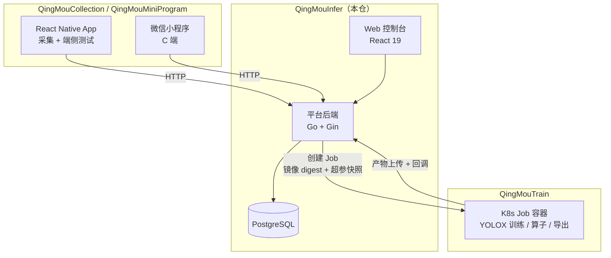

# QingMouInfer · 轻眸识刻基础训练平台

> 轻眸识刻的**控制面**：把「一堆乱图和视频」变成「可复现、可上线、可迭代的检测模型」的一体化工作台。

本仓是 [轻眸识刻](https://github.com/QingMouFoodDate/QingMouPRD) 的**平台后端与 Web 控制台**，
负责数据、标注、训练调度、模型资产的全部控制面能力。实际跑在训练容器里的代码在
[QingMouTrain](https://github.com/QingMouFoodDate/QingMouTrain)，端侧在
[QingMouCollection](https://github.com/QingMouFoodDate/QingMouCollection)。

---

## 一、在整体架构中的位置



**归属判据**：跑在**服务端进程**里的逻辑属于本仓。

---

## 二、功能范围

### 做（一期）

| 区域 | 能力 |
| :--- | :--- |
| **数据集** | 本地上传 / 压缩包导入 / 标准格式（COCO·YOLO·VOC·LabelMe）导入 / 视频抽帧；图库浏览与筛选；**自动体检**（损坏、重复、近重复、无目标、尺寸异常）；**数据集版本**（不可变快照 + 按 `group_key` 分组切分）；检索；导出 COCO |
| **标注** | 标注台（矩形框、快捷键、自动保存、乐观锁防覆盖）；类别体系（颜色、快捷键、重命名零回填） |
| **训练** | 计算节点视图；镜像登记（**以 digest 固定**）；任务提交与排队；k3s Job 下发；心跳与看门狗；实时日志与指标曲线 |
| **模型** | 模型仓库与**血缘**（数据版本 + 超参 + 镜像 digest + 代码版本）；在线试跑；误检一键归档回待标注池 |
| **系统** | 登录与单管理员；统一错误码 |

### 不做（一期明确排除）

- ❌ RBAC 四角色权限矩阵、审计日志哈希链、告警规则引擎
- ❌ 采集项目 / SOP / 派单 / 验收 / 绩效整套作业链
- ❌ 标注派单、双标一致性、质检返工、标注绩效
- ❌ 可视化流水线画布（**数据→训练的链路固定**，不做自由编排）
- ❌ 模型服务灰度、回滚、Router、调用统计看板
- ❌ 多租户

> 完整范围依据见 [SCOPE.md](https://github.com/QingMouFoodDate/QingMouPRD/blob/main/SCOPE.md)。

---

## 三、技术栈

| 层 | 选型 |
| :--- | :--- |
| 后端语言 | **Go** |
| Web 框架 | **Gin** |
| 数据库 | **PostgreSQL**（单库，不引入 ES / MQ） |
| 对象存储 | **本地目录** 或 **S3 兼容（MinIO）** |
| 训练调度 | **k3s / K8s Job**（`client-go` 创建 Job，`nvidia.com/gpu` 声明） |
| 前端 | **React 19 + TypeScript + Vite** |
| 部署 | Docker Compose（单机） |

**刻意的约束**：单机 Local-First、2~3 人规模。不引入微服务拆分、Kafka、消息队列、Redis 集群——
它们的复杂度在这个规模下不产生任何价值。

---

## 四、规划目录结构

```text
QingMouInfer/
├── cmd/
│   └── server/              # 服务入口
├── internal/
│   ├── api/                 # Gin 路由与 handler
│   ├── domain/              # 领域实体（纯净 struct，不依赖框架）
│   ├── service/             # 业务逻辑
│   ├── store/               # PostgreSQL 持久化
│   ├── storage/             # 对象存储抽象（本地 / S3）
│   ├── scheduler/           # k3s Job 下发与看门狗
│   └── worker/              # 缩略图、抽帧、预检等后台任务
├── migrations/              # 数据库迁移
├── web/                     # React 19 + Vite 控制台
│   └── src/
│       ├── pages/           # 数据集 / 标注 / 训练 / 模型 / 端侧
│       ├── components/
│       └── api/
├── deploy/
│   └── docker-compose.yml
└── README.md
```

---

## 五、核心数据实体

| 实体 | 说明 |
| :--- | :--- |
| `Dataset` / `DatasetVersion` | 数据集与**不可变版本快照**；版本是血缘的挂载点 |
| `DatasetVersionItem` | 版本成员：`sample_id` / `split` / `group_key`（快照） |
| `DataSample` | 单条数据（一张图或一帧）；`group_key` 是真源 |
| `ManagedFile` | 文件统一抽象；`owner_type` 固定 8 值，**一个物理文件只登记一条** |
| `LabelClass` / `Annotation` | 类别与标注（矩形框等几何，原图归一化坐标） |
| `TrainTask` | 训练任务；状态机 + `attempt` 重试，**不引入 TrainRun** |
| `Model` / `ModelVersion` | 模型与版本；落库时写死血缘，此后不可回写 |

---

## 六、跨仓契约

本仓与另外两个仓之间的接口是**唯一事实来源**，任一方变更必须同步。

### 与 QingMouTrain：Job 规约

| 项 | 约定 |
| :--- | :--- |
| 触发 | 创建 K8s Job，GPU 以 `resources.limits: nvidia.com/gpu` 声明 |
| 镜像 | **固定 image digest**，`imagePullPolicy: IfNotPresent` |
| 入参 | 超参快照（`params_hash`）+ 数据物化路径（预签名 URL 或 PVC）+ 输出目录 + `attempt` |
| 超参传递 | 由快照生成白名单化的 `exp_override.py` 与只读 `train_args.json` |
| 产物 | 输出目录 `YOLOX_outputs/<experiment_name>/`，命名固定 |
| 出站 | 容器内上传对象存储后回调本仓；幂等键 `(train_task_id, attempt)` |
| 失败分工 | 容器崩溃 → K8s `restartPolicy`；Pod 终态 Failed → 平台按 `attempt` 重试 |

### 与端侧：HTTP 契约

上传链路的权威定义在本仓（`UploadSession` / `UploadChunk` / `ManagedFile`），端只实现；
模型下发由本仓提供清单与预签名 URL，端侧校验 sha256 后缓存。

---

## 七、快速开始

```bash
# 依赖：Go 1.23+、Node 20+、PostgreSQL 16+、Docker
git clone git@github.com:QingMouFoodDate/QingMouInfer.git
cd QingMouInfer

# 一键起（含数据库与对象存储）
docker compose -f deploy/docker-compose.yml up -d

# 后端
go run ./cmd/server

# 前端
cd web && npm install && npm run dev
```

---

## 八、相关文档

| 文档 | 内容 |
| :--- | :--- |
| [PLAN.md](https://github.com/QingMouFoodDate/QingMouPRD/blob/main/PLAN.md) | 产品形态一页 + Issue 清单 |
| [SCOPE.md](https://github.com/QingMouFoodDate/QingMouPRD/blob/main/SCOPE.md) | 范围界定：必做 / 工程约束 / 收敛项 |
| [REPOS.md](https://github.com/QingMouFoodDate/QingMouPRD/blob/main/REPOS.md) | 仓库地图与跨仓契约 |
| [PRD.md](https://github.com/QingMouFoodDate/QingMouPRD/blob/main/PRD.md) | 各模块详细需求 |

---

## License

内部项目，未经许可不得外传。
